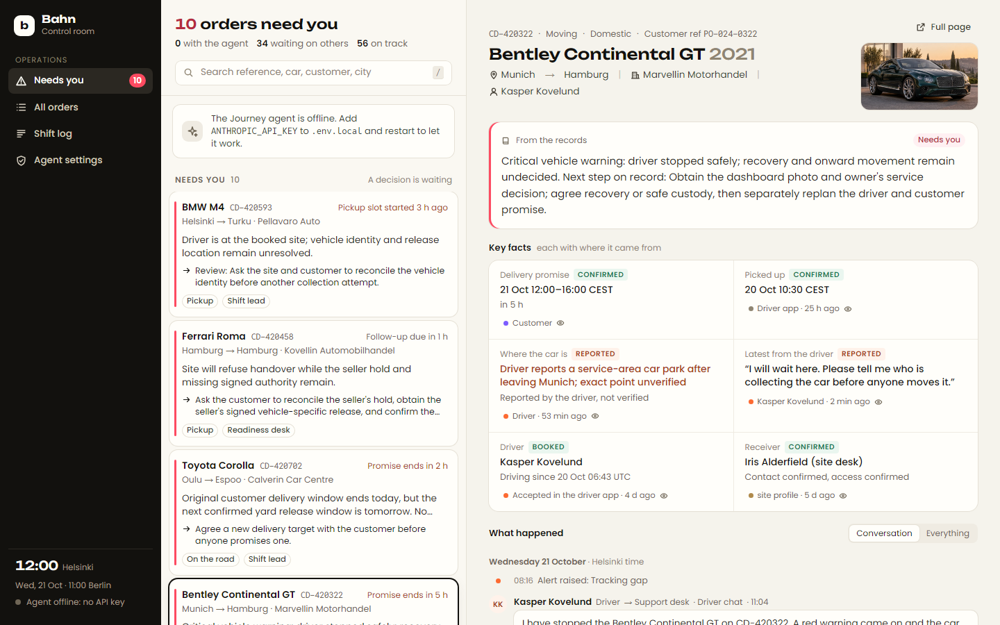
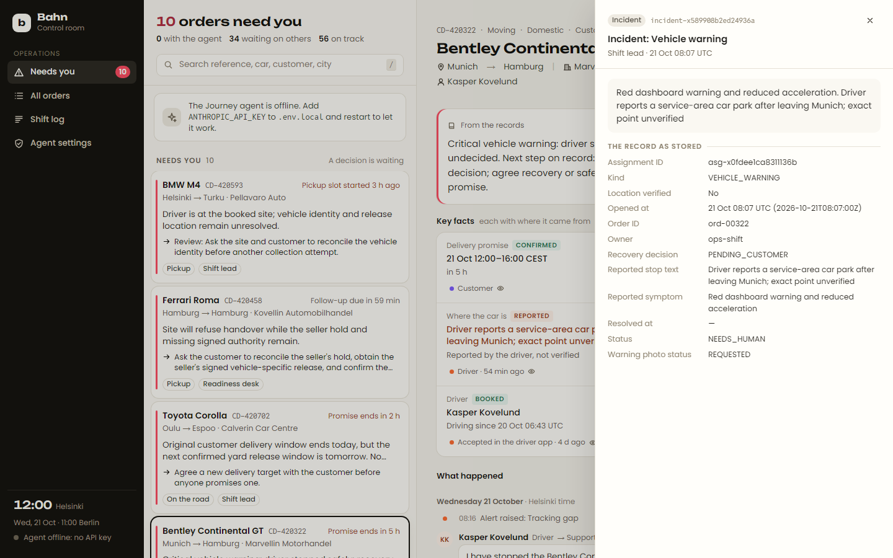
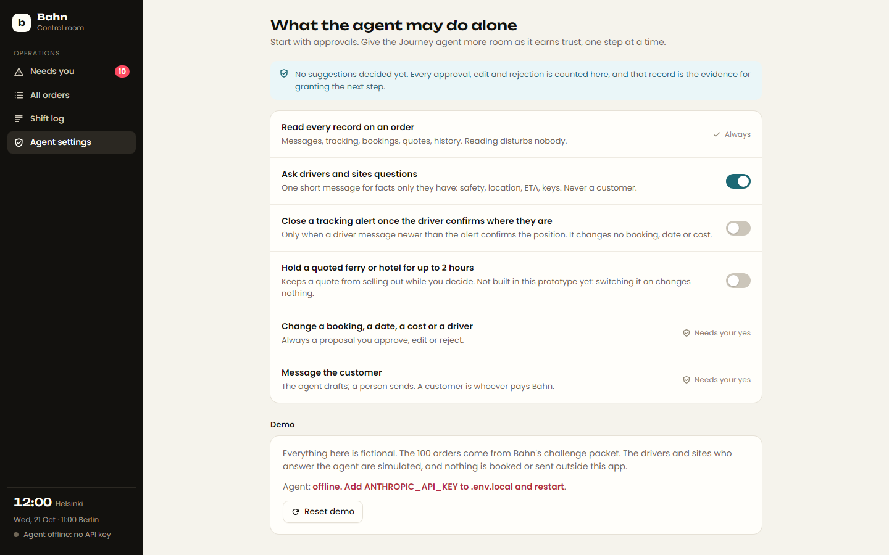
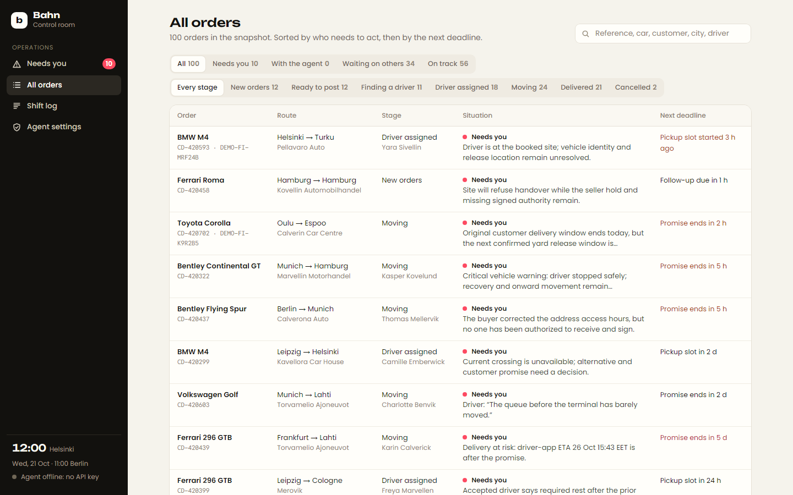
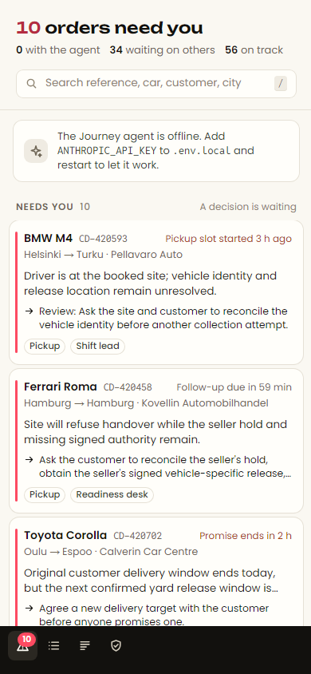

# Bahn Control Room

**The place where Bahn's operations people and agents work together to get every car delivered.** It shows a person only the orders that need them, says why in one sentence, and puts the decision, the evidence and a way to say yes on one screen. Beside it runs the **Journey agent**, a real Claude agent for problems on the road: breakdowns, ferry trouble, missed handovers, drivers who cannot make a pickup. It reads the records first, asks the driver only what the records cannot answer, and brings a person one clear decision. It never contacts a customer and never changes a booking, date or cost without a yes.

Built for Bahn's *Car Delivery Control Room* challenge at the Prompt Operations Hackathon, 24–25 October 2026. Everything in it is fictional: the 100 orders come from Bahn's synthetic packet, and the drivers who answer the agent are simulated.



## Run it

You need Node.js 24 or newer. No database, no Docker.

```sh
npm install
cp .env.example .env.local     # then add ANTHROPIC_API_KEY or OPENROUTER_API_KEY
npm run dev
```

Open http://localhost:3000.

Without a key, everything works except the agent: you can triage, open cases, follow every fact to its source and approve or reject recorded proposals. With a key, the agent investigates live and a simulated driver answers it.

| Command | What it does |
| --- | --- |
| `npm run dev` | The control room at http://localhost:3000 |
| `npm test` | 15 tests: triage rules, facts with sources, and the agent loop end to end with a scripted model (no key needed) |
| `npm run agent:run -- CD-420322` | Runs the real agent on one order in the terminal and writes the full trace to `traces/` |
| `npm run queue` | Prints the worklist in the terminal |
| `npm run case -- CD-420322` | Prints one case: briefing, facts with sources, timeline |
| `npm run reset` | Puts the demo back to the recorded seed (also in Agent settings). `npm run reset -- --clean` starts from the bare packet with no agent work |
| `npm run typecheck` / `npm run build` | Type check and production build |

## What you see

**Needs you.** The worklist splits all 100 orders by who has to act next:

- **Needs you** (about 10): a decision is waiting. Each row says what is wrong, what the next decision is, who owns it, and the deadline that matters ("Promise ends in 2 h").
- **Agent is on it**: the Journey agent is investigating or waiting for a driver's reply. It comes back when it needs a yes.
- **Waiting on others**: owned, or waiting on a customer, site or carrier.
- **On track** (about 55): collapsed to a count per stage. Each one says what was checked (alerts, conversations, incidents, open work and, on the road, a recent position and an ETA within the promise). An order nobody can vouch for is not on track: a moving car with no position for 4 hours comes out with "No driver-app position for 8 h".

Move with `j`/`k`, search with `/`. The most urgent case opens on the right.

**A case** answers four questions in a few seconds:

1. *What is going on?* A short briefing, from the agent when it has worked the case, otherwise from the records.
2. *What do I need to decide?* The agent's suggestion: the situation with who said what and when, the recommendation, exactly what changes if you approve, the drafted message to the customer (you edit and send it) and to the driver (the agent sends it after your yes), other options, what is still unknown, and the records it rests on. Approve, edit or reject with a reason. Afterwards the case shows what was done and what happens next.
3. *Can I trust the facts?* Key facts (promise, position, ETA, driver, ferry, receiver), each marked *confirmed*, *reported*, *estimate*, *stale*, *booked* or *quote only*, each with its source. Click a source to see the record behind it.
4. *What happened?* Messages, notes and events in order, with who spoke to whom on which channel. Internal notes look different from messages; simulated replies are labelled.

**Shift log** lists what the agent did, what drivers answered and what people decided. **Agent settings** is a trust ladder: what the agent may do alone, with the approval record that justifies giving it the next step.

| | |
| --- | --- |
|  |  |
|  |  |

## The Journey agent

An Opus 5.5 model in a tool loop (`lib/agent/run.ts`), with one conversation per order. Its tools come in the order it should use them:

| Kind | Tools | Needs a yes? |
| --- | --- | --- |
| Read | `read_case`, `read_messages`, `read_tracking`, `read_travel`, `read_place`, `read_history`, `find_drivers`, `check_sailings`, `find_recovery_options` | No |
| Ask | `message_driver`, `message_site` (refused when the site belongs to the paying customer) | No, can be switched off |
| Decide | `add_note`, `propose_decision`, `close_tracking_alert` (only when granted), `finish` | The proposal *is* the request for a yes |

There is no tool that messages a customer, books, cancels or changes a date, promise, cost or driver. Those exist only as proposals, and only a person's approval carries them out (`lib/actions.ts`). The rules hold in code, not just in the prompt, and `npm test` checks them.

How a run goes:

1. Something flags the order (an alert, an incident, a promise at risk), or a person asks.
2. The agent reads the case, messages, tracking and travel, and weighs each claim the way Bahn's operations guide asks: a quote is not a booking, an alert is not a diagnosis, a driver's message is a report rather than a verified location, and the newer record wins.
3. If only the driver knows something that changes the decision, it asks once, in one message, and ends its turn. The simulated driver answers a few seconds later (`lib/agent/sim.ts`), and the reply wakes the agent.
4. It brings one decision with evidence, or finishes with "nothing for a person to do" and says why.
5. When you approve, the control room sends your (edited) customer message from Bahn, records each approved change as an event with you as the actor, sends the driver message, and wakes the agent to follow up. When you reject, your reason goes back to the agent. "I'll take it" stops the agent on that case.

The agent can run in the background. On the worklist, "Let it look" sends it through every open road case, three at a time, so a person arrives to briefings and decisions instead of raw alerts.

Model details: `claude-opus-5-5` with adaptive thinking (summarised reasoning is kept and shown under each step as "Why"), effort `medium`, prompt caching on a fixed system prompt and tool list, and server-side refusal fallback. The model, effort and simulated-driver model can be changed in `.env.local`.

## How it is built

```
dataset/*.jsonl ─► lib/data (in memory) ─► + lib/state overlay (.state/overlay.json)
                                               │
          Bahn's reading layer  lib/present ◄──┘   (labels, attention, record view)
                                   │
       lib/triage.ts  who must act, why, by when
       lib/case.ts    briefing · decision · facts with sources · timeline
       lib/agent/     prompt · tools · loop · simulated driver · model
       lib/actions.ts approve · reject · ask · take over
                                   │
       app/ (Next.js 16)  worklist · case · all orders · shift log · agent settings
```

- **No database.** The JSONL packet is read into memory, and everything people and agents do goes into an overlay saved to `.state/overlay.json`. A fresh clone runs with `npm install && npm run dev`. The dataset files are never modified.
- **Bahn's starter reading layer is kept** (`lib/present/`). Its attention rules and labels already encode the packet's evidence boundaries. Only the loader was replaced, to read from memory instead of Postgres.
- **Simulated clock.** The packet is a snapshot at 21 October 09:00 UTC. The control room's clock starts there and moves with real time, so new messages and decisions land after the recorded ones.
- **Recorded runs.** `npm run seed:save` freezes the current demo state into `state/seed.json`, and a fresh clone starts from it. That way judges see real agent work even without a key. `npm run agent:run` writes each run's full trace to `traces/`.

## When the agent fails, and handing over

- **Failure.** If the agent stops with an error, the order jumps to *Needs you* with "The Journey agent stopped before finishing" and the reason. You can take over or ask it to continue.
- **Handing over.** "I'll take it" stops the agent on a case and withdraws its pending suggestion. "Hand back to the agent" returns it; the agent first checks what changed while you had it.
- **Corrections.** Instead of a bare reject, *Choose another step* asks what should happen instead. The agent acts on it, and the correction is kept as a lesson it reads on every new case (listed in Agent settings), in line with Bahn's "every mistake becomes a test".

## Troubleshooting

- **The page keeps reloading in dev.** You ran `npm run build` while `npm run dev` was running; they share `.next`. Stop dev, delete `.next`, start dev again.
- **OpenRouter key.** Put it in `OPENROUTER_API_KEY`. Model names then use OpenRouter's form, e.g. `AGENT_MODEL=anthropic/claude-sonnet-5.5` for a cheaper run.
- **"Agent offline".** No key was found in `.env.local`; restart `npm run dev` after adding one.

## Documents

- [docs/WRITEUP.md](docs/WRITEUP.md): the submission write-up for the hub.
- [docs/HOW-WE-BUILT-IT.md](docs/HOW-WE-BUILT-IT.md): how we worked with Claude Code: what we asked, what we checked, what we threw away.
- [docs/DEMO-SCRIPT.md](docs/DEMO-SCRIPT.md): a 2½-minute video plan.
- [docs/QUESTIONS-FOR-BAHN.md](docs/QUESTIONS-FOR-BAHN.md): open questions for Bahn's team.
- [docs/bahn/](docs/bahn/): Bahn's brief and operations context, as given.

## Data and credits

`dataset/`, `attachments/`, `check_packet.py`, `public/car-images/`, `public/car-logos/` and the reading layer in `lib/present/` come from Bahn's challenge repository ([Bahn-Express/car-delivery-control-room](https://github.com/Bahn-Express/car-delivery-control-room)). All names, companies, places, messages and bookings in them are fictional. Recovery providers and later ferry sailings that the agent looks up are made up too, and are labelled as simulated wherever they appear.
